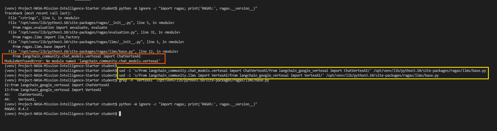

# NASA Mission Intelligence – RAG Chat with Real-Time RAGAS Evaluation

Udacity Generative AI Fundamentals project submission.

A complete Retrieval-Augmented Generation (RAG) system over NASA mission documents
(Apollo 11, Apollo 13 and the Space Shuttle Challenger / STS-51L):

- **Embedding pipeline** – chunks the raw `.txt` transcripts and reports, embeds them with
  OpenAI `text-embedding-3-small` and persists them with metadata in a ChromaDB collection.
- **RAG client** – semantic search over ChromaDB with optional per-mission metadata filtering,
  and clean, source-attributed context construction.
- **LLM client** – a NASA-expert system prompt, conversation history management and grounded
  answer generation with `gpt-4.1-mini` (or `gpt-4.1` / `gpt-4o`).
- **RAGAS evaluator** – scores every answer in real time on answer relevancy, faithfulness and
  context precision; BLEU and ROUGE are added when a reference answer is available.
- **Streamlit chat app** – ties everything together with backend / model / mission selection,
  retrieved-source display and live quality metrics.
- **Batch evaluation** – runs the full pipeline over `evaluation_dataset.txt` and reports
  per-question scores plus aggregates.

---

## Table of contents

1. [Project structure](#project-structure)
2. [Architecture](#architecture)
3. [Setup](#setup)
4. [Running with Docker](#running-with-docker)
5. [Running the project end to end](#running-the-project-end-to-end)
6. [Evaluation dataset and batch evaluation](#evaluation-dataset-and-batch-evaluation)
7. [Evaluation results](#evaluation-results)
8. [Automated tests](#automated-tests)
9. [Rubric mapping](#rubric-mapping)
10. [Design decisions](#design-decisions)
11. [RAGAS 0.4.3 / LangChain compatibility](#ragas-043--langchain-compatibility)

---

## Project structure

```
.
├── chat.py                  # Streamlit chat application (UI + integration)
├── embedding_pipeline.py    # Chunking, OpenAI embeddings, ChromaDB persistence, CLI
├── rag_client.py            # Backend discovery, semantic retrieval, context formatting
├── llm_client.py            # System prompt, history management, OpenAI chat completion
├── ragas_evaluator.py       # RAGAS metrics for a (question, contexts, answer) triple
├── ragas_compat.py          # Import shim so RAGAS 0.4.3 works with current LangChain
├── batch_evaluate.py        # Batch evaluation over evaluation_dataset.txt
├── evaluation_dataset.txt   # 10 test questions with expected answers (6 categories)
├── tests/
│   ├── test_embedding_pipeline.py   # Offline tests for chunking / pipeline
│   └── test_rag_llm_eval.py         # Offline tests for retrieval, LLM, evaluator, dataset
├── data_text/               # Raw NASA documents (apollo11/, apollo13/, challenger/)
├── chroma_db_openai/        # ChromaDB persist directory (created by the pipeline, git-ignored)
├── requirements.txt
├── Dockerfile               # Container image (Python 3.12 + uv-installed requirements)
├── docker-entrypoint.sh     # Builds the vector DB, then starts Streamlit
├── docker-compose.yml       # One-command run: docker compose up -d
├── .env.example             # OPENAI_API_KEY template
└── fix_ragas.png            # Screenshot of the RAGAS import fix
```

## Architecture

```
                 embedding_pipeline.py (offline, once)
 data_text/*.txt ───► chunk (size/overlap) ───► OpenAI embeddings ───► ChromaDB collection
                                                                        (text + metadata:
                                                                         mission, source,
                                                                         document_category,
                                                                         chunk_index, ...)

                 chat.py / batch_evaluate.py (online, per question)
 question ──► rag_client.retrieve_documents ──► top-k chunks (+ mission filter)
                     │                                  │
                     │                      rag_client.format_context
                     │                        (sorted by distance, de-duplicated,
                     │                         "[Source N] Mission | Document | Type" headers)
                     ▼                                  ▼
          llm_client.generate_response(system prompt + history + context + question)
                     │
                     ▼
                  answer ──► ragas_evaluator.evaluate_response_quality(question, answer, contexts)
                                      │
                                      ▼
                     answer_relevancy · faithfulness · context_precision (· bleu · rouge)
```

## Setup

Requirements: Python 3.10+ (developed on 3.12) and an OpenAI API key.

```bash
python -m venv .venv && source .venv/bin/activate     # or: uv venv
pip install -r requirements.txt                       # or: uv pip install -r requirements.txt

cp .env.example .env            # then put your key in .env
# or
export OPENAI_API_KEY="sk-..."
```

All scripts load `.env` automatically (`python-dotenv`). The Streamlit app also accepts the key
in the sidebar.

## Running with Docker

The quickest way to run everything is Docker. The only prerequisite is an OpenAI API key.

```bash
cp .env.example .env            # put your OPENAI_API_KEY in .env
docker compose up -d
```

Then open <http://localhost:8501>.

On start the container:

1. reads `OPENAI_API_KEY` from `.env` (it refuses to start without it);
2. runs `embedding_pipeline.py` over `data_text/` with `--update-mode skip`, so documents that
   are already embedded are not sent to OpenAI again;
3. starts the Streamlit chat app on port 8501.

The ChromaDB directory lives in the named volume `chroma_data`, so embeddings survive restarts
and `docker compose down`. `data_text/` is bind-mounted read-only, so dropping new documents
there and running `docker compose restart` embeds only the new files.

Useful commands:

```bash
docker compose logs -f                  # watch the embedding progress / app logs
docker compose restart                  # re-run the pipeline (picks up new documents)
docker compose down -v                  # stop and delete the vector database
docker compose exec nasa-rag-chat \
    python batch_evaluate.py --openai-key "$OPENAI_API_KEY" --n-results 3   # batch evaluation inside the container
```

Behaviour can be tuned with environment variables in `.env` or `docker-compose.yml`:

| Variable | Default | Purpose |
|----------|---------|---------|
| `CHUNK_SIZE` / `CHUNK_OVERLAP` | `1000` / `200` | Chunking strategy used when building the DB |
| `UPDATE_MODE` | `skip` | `skip`, `update` or `replace` already-embedded documents |
| `COLLECTION_NAME` | `nasa_space_missions_text` | ChromaDB collection name |
| `SKIP_EMBEDDING` | `false` | `true` starts the UI without running the pipeline |

## Running the project end to end

### 1. Build the vector database

```bash
python embedding_pipeline.py \
    --openai-key "$OPENAI_API_KEY" \
    --data-path ./data_text \
    --chroma-dir ./chroma_db_openai \
    --collection-name nasa_space_missions_text \
    --chunk-size 1000 --chunk-overlap 200 \
    --update-mode skip
```

Useful options:

| Flag | Purpose |
|------|---------|
| `--chunk-size` / `--chunk-overlap` | Chunking strategy, configurable at runtime |
| `--update-mode skip\|update\|replace` | How already-embedded documents are handled |
| `--stats-only` | Print collection size and per-mission / per-category / per-type counts |
| `--test-query "..."` | Run a similarity query after processing |
| `--delete-source PATTERN` | Remove the chunks of a given source file |

Inspect the collection:

```bash
python embedding_pipeline.py --openai-key "$OPENAI_API_KEY" --chroma-dir ./chroma_db_openai --stats-only
```

### 2. Launch the chat application

```bash
streamlit run chat.py
```

In the sidebar you can choose the ChromaDB backend (every `chroma*` directory and collection in
the project is auto-discovered), the OpenAI model, how many chunks to retrieve (k), the
**mission focus** (metadata filter: all / Apollo 11 / Apollo 13 / Challenger) and whether RAGAS
evaluation runs. Each answer shows the retrieved sources in an expander and the RAGAS scores
of the last answer appear in the sidebar.

### 3. Run the batch evaluation

```bash
python batch_evaluate.py --openai-key "$OPENAI_API_KEY" \
    --chroma-dir ./chroma_db_openai --collection-name nasa_space_missions_text \
    --n-results 3 --output results.csv
```

`--limit N` evaluates only the first N questions, `--no-mission-filter` searches across all
missions, `--output` accepts `.csv` or `.json`.

## Evaluation dataset and batch evaluation

`evaluation_dataset.txt` contains 10 mission-relevant questions covering the six rubric
categories (**overview, emergency, disaster analysis, crew, technical, timeline**) across all
three missions. Each record has the question, the mission to filter on and the answer the
system is expected to give (used as the reference for BLEU / ROUGE):

```text
Category: emergency
Mission: apollo13
Question: What happened to Apollo 13 and how did the crew report the problem to Houston?
Expected: About 56 hours into the flight an oxygen tank in the Service Module exploded ...
---
```

`batch_evaluate.py` loads the file (`load_evaluation_dataset`), runs retrieve → generate →
evaluate for every question and prints:

- a per-question block: category, mission, number of contexts, the answer and every metric;
- an aggregate table with mean / min / max / n for each metric;
- the number of questions that could not be evaluated, with their error messages.

The same questions double as the manual test script for the chat UI.

## Evaluation results

_Results of `python batch_evaluate.py --n-results 3` on the full corpus
(`chroma_db_openai`, chunk size 1000 / overlap 200, `gpt-4.1-mini` for generation and
evaluation). Scores are in [0, 1]; higher is better._

<!-- RESULTS_TABLE_START -->
Pending: the batch evaluation is run after the embedding pipeline completes; see `results.csv`.
<!-- RESULTS_TABLE_END -->

Interpretation of the metrics:

| Metric | What it measures |
|--------|------------------|
| `answer_relevancy` | How well the answer addresses the question (embedding similarity between the question and questions generated from the answer). |
| `faithfulness` | Fraction of claims in the answer that are supported by the retrieved context. Low values mean the model added facts not in the context. |
| `context_precision` | Whether the retrieved chunks were actually useful for the answer (retrieval quality). |
| `bleu_score` / `rouge_score` | Lexical overlap with the expected answer; only computed in batch mode where a reference exists. These are naturally low for paraphrased answers. |

## Automated tests

```bash
pytest tests/ -v
```

The suite is fully offline (OpenAI and the RAGAS metric objects are replaced with fakes;
ChromaDB persists to a temporary directory) and covers:

- chunking: chunks never exceed `chunk_size`, cover the whole text and carry indexed metadata;
  deterministic document ids; update modes `skip` / `update` / `replace`; metadata extraction;
  source deletion; persistence across client instances; collection statistics;
- backend discovery, collection initialization, retrieval with and without mission filter,
  context formatting (headers, ordering by distance, de-duplication, truncation);
- system prompt and message construction, history trimming, OpenAI call parameters;
- evaluator input validation (empty / malformed inputs return an error, never raise),
  metric orchestration (one failing metric does not lose the others);
- the evaluation dataset loads and covers the required categories and missions;
  aggregate computation of the batch evaluator.

Current status: **62 tests passing**.

## Rubric mapping

### Embedding & data pipeline

| Criterion | Where / how |
|-----------|-------------|
| Chunking strategy with runtime `chunk_size` / `chunk_overlap` | `embedding_pipeline.py` `ChromaEmbeddingPipelineTextOnly.chunk_text`; CLI flags `--chunk-size`, `--chunk-overlap`. Chunks are cut at sentence boundaries inside the window so they never exceed `chunk_size`; the next chunk starts `chunk_overlap` characters before the previous end. Verified by `tests/test_embedding_pipeline.py`. |
| Embedding creation with metadata | `get_embedding` calls OpenAI `text-embedding-3-small` per chunk; `process_text_file` stores `source`, `file_path`, `mission`, `data_type`, `document_category`, `file_type`, `content_type`, `file_size`, `processed_timestamp`, and per chunk `chunk_index`, `chunk_size`. |
| `--update-mode skip / update / replace` | `add_documents_to_collection` checks deterministic document ids (`generate_document_id`) and skips, updates or deletes-and-re-adds accordingly. |
| Persist and inspect ChromaDB | `chromadb.PersistentClient(--chroma-dir)` + `--collection-name`; `--stats-only` prints total chunks and counts per mission, data type, document category and file type (`get_collection_stats`). |

### Retrieval & LLM integration

| Criterion | Where / how |
|-----------|-------------|
| Semantic retrieval from ChromaDB | `rag_client.retrieve_documents` embeds the question with the same OpenAI model (`embed_query`) and runs `collection.query(query_embeddings=..., n_results=k, where=...)`. `k` comes from the sidebar slider / `--n-results`. Mission filtering uses the `where={"mission": ...}` metadata clause (`build_mission_filter`). |
| Clean context construction | `rag_client.format_context` sorts chunks by distance, removes duplicate snippets, truncates long chunks and labels each as `[Source N] Mission: ... \| Document: ... \| Type: ... \| Distance: ...` under a single header. |
| System prompt and conversation management | `llm_client.SYSTEM_PROMPT` positions the assistant as a NASA mission historian who must ground answers in the context, cite `(Source N)`, and state uncertainty. `_build_messages` keeps the last `MAX_HISTORY_TURNS` well-formed user/assistant turns and puts fresh context only in the current user turn. |
| Grounded answers | `generate_response` sends system prompt + history + context + question to OpenAI (`temperature=0.2`). When no documents are retrieved the model is told to say so explicitly. |

### Real-time evaluation

| Criterion | Where / how |
|-----------|-------------|
| RAGAS metrics (≥ relevancy + faithfulness) | `ragas_evaluator.evaluate_response_quality` computes `ResponseRelevancy`, `Faithfulness` and `LLMContextPrecisionWithoutReference`; `BleuScore` and `RougeScore` when a reference is given. Evaluator LLM `gpt-4.1-mini`, evaluator embeddings `text-embedding-3-small`. |
| Evaluates a (question, context, answer) triple | Builds a `SingleTurnSample` and returns `{metric_name: value}`; `validate_inputs` returns `{"error": ...}` for empty question / answer / contexts or wrong types, and a failing metric becomes a `warnings` entry instead of a crash. |
| Batch evaluation using a test set | `batch_evaluate.py` loads `evaluation_dataset.txt`, runs the end-to-end pipeline per question and prints per-question scores and mean / min / max per metric; optional CSV / JSON export. |
| Evaluation dataset | `evaluation_dataset.txt`: 10 questions, categories overview / emergency / disaster analysis / crew / technical / timeline, missions Apollo 11 / Apollo 13 / Challenger. Loaded by `batch_evaluate.load_evaluation_dataset` and checked by the tests. |

### Chat application

| Criterion | Where / how |
|-----------|-------------|
| Interactive chat | `chat.py` Streamlit `st.chat_input` / `st.chat_message`, session-state message history, "Clear conversation" button. |
| Integration of all components | Backend discovery (`rag_client`), retrieval with mission filter, answer generation (`llm_client`), real-time scoring (`ragas_evaluator`). |
| Display of answer and quality scores | Answer rendered as Markdown with a "Retrieved sources" expander; RAGAS scores as metrics + progress bars in the sidebar, errors / warnings surfaced there too. |

## Design decisions

- **Query embeddings are computed explicitly.** The pipeline stores pre-computed OpenAI vectors,
  so the collection is created with ChromaDB's default embedding function configuration.
  Passing an OpenAI embedding function at `get_collection` time would raise a conflict in
  ChromaDB ≥ 1.0, so `rag_client` embeds the question itself with `text-embedding-3-small` and
  queries with `query_embeddings`. This guarantees documents and queries live in the same vector
  space.
- **Context goes into the current user turn, not the system prompt.** The system prompt stays
  constant (persona + rules), while the retrieved context changes per question. This keeps the
  history compact and avoids stale context from earlier turns influencing the answer.
- **History is trimmed to the last 10 turns** to include only necessary context for each call.
- **Metrics are evaluated one by one.** A single failing metric (for example a parsing failure in
  the evaluator LLM output) is reported as a warning and the other scores are still returned.
- **Reference-based metrics are optional.** BLEU / ROUGE only run when an expected answer is
  supplied (batch mode) and their packages are present; the chat UI reports the three
  reference-free metrics.

## RAGAS 0.4.3 / LangChain compatibility

RAGAS 0.4.3 imports `ChatVertexAI` from `langchain_community.chat_models.vertexai`, a module
that no longer exists in `langchain-community` 0.4. Without a fix, `import ragas` fails with:

```text
ModuleNotFoundError: No module named 'langchain_community.chat_models.vertexai'
```

Two ways to resolve it:

1. **Runtime shim (used by this project, no package changes).** `ragas_compat.py` registers
   the old import paths against `langchain-google-vertexai` before `ragas` is imported.
   `ragas_evaluator.py` imports it first, so `chat.py` and `batch_evaluate.py` work out of the
   box. If `import ragas` already succeeds the shim does nothing.

2. **Patch the installed package** (as described in the course material, see `fix_ragas.png`):

   ```bash
   RAGAS_BASE=$(python -c "import importlib.util, os; print(os.path.join(os.path.dirname(importlib.util.find_spec('ragas').origin), 'llms', 'base.py'))")
   sed -i 's/from langchain_community.chat_models.vertexai import ChatVertexAI/from langchain_google_vertexai import ChatVertexAI/' "$RAGAS_BASE"
   sed -i 's/from langchain_community.llms import VertexAI/from langchain_google_vertexai import VertexAI/' "$RAGAS_BASE"
   python -W ignore -c "import ragas; print('RAGAS:', ragas.__version__)"
   ```

   On macOS use `sed -i ''`. The patch must be reapplied if the environment is recreated.


